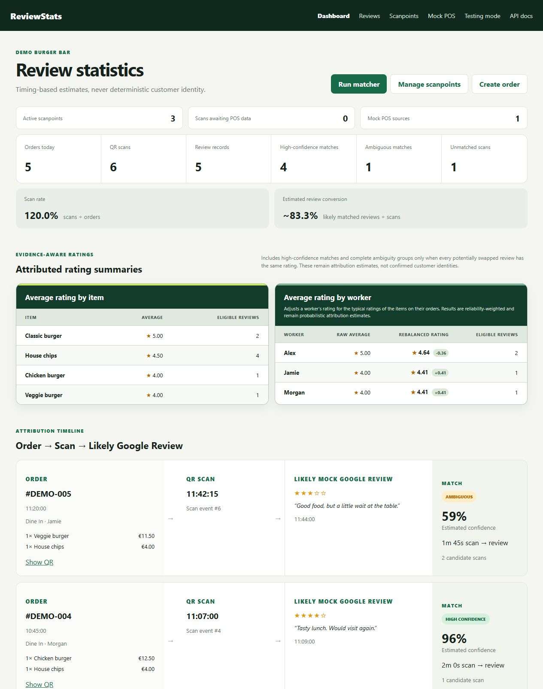
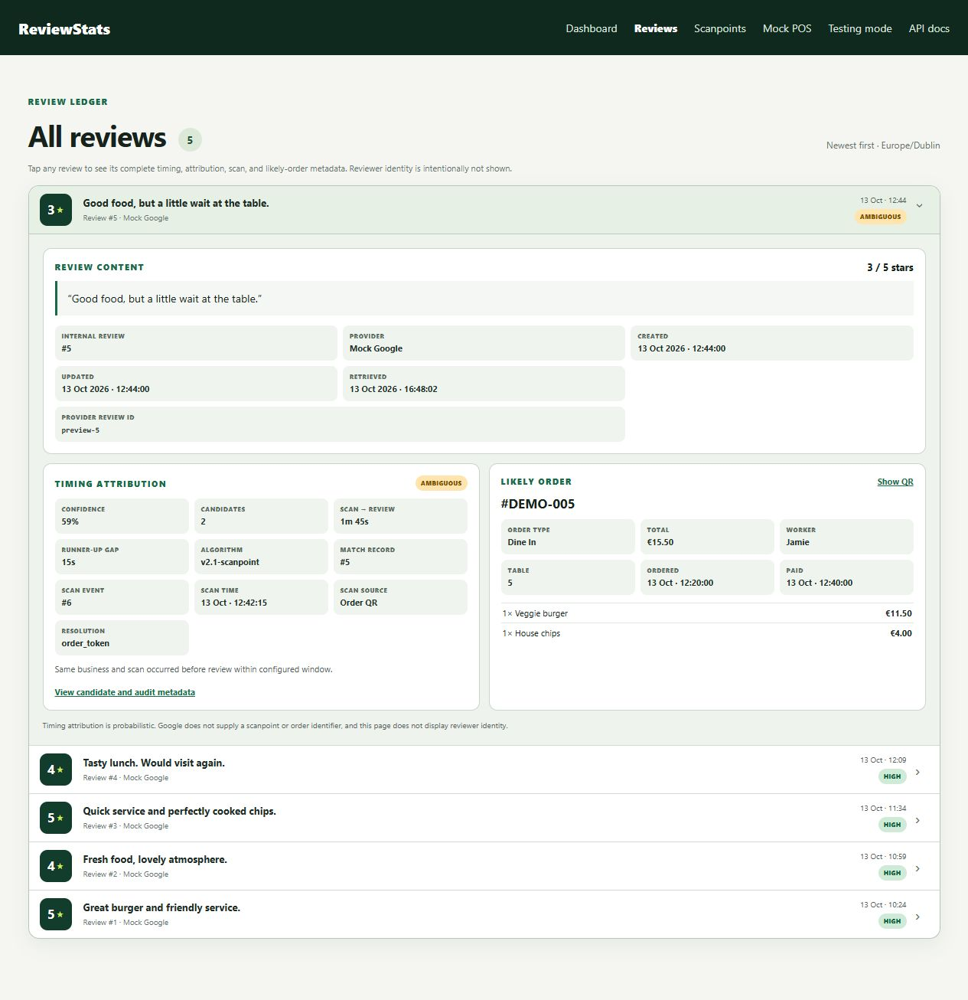

# ReviewStats

A personal web application connecting mock POS orders, QR/NFC scans and simulated reviews through explainable attribution and owner analytics.

**Built with:** Python, FastAPI, SQLAlchemy, SQLite, Pydantic, Jinja and JavaScript. Tested with Pytest; Docker and GitHub Actions configurations are included.

ReviewStats explores a simple question: **which order is a review most likely to belong to?** It brings orders, scans and reviews into one place, uses scan timing to rank possible matches, and lets the owner investigate the evidence behind each result.

[Preview](#site-preview) · [Quick start](#quick-start) · [Demo](#try-the-demo) · [Project structure](#project-structure) · [Matching](docs/MATCHING.md) · [Tests](#tests)

## Site preview

Screenshots of the local demo using synthetic orders, scans and reviews.

### Dashboard

Operational metrics, attributed item and worker ratings, and the order → scan → review timeline with confidence estimates.



### Review ledger

Reviews with expandable timing, attribution and likely-order details, including the evidence behind an ambiguous match.



## Features

- **Review ledger with detailed investigation views** — browse reviews newest first and expand a record to inspect its timestamps, match status, confidence, scan source and likely order. Follow the attribution API link for the competing candidates and previous decisions, so uncertain results can be investigated.
- **Operational dashboard and owner analytics** — follow the order → scan → review timeline and see active scanpoints, scans awaiting POS data, high-confidence matches, ambiguous results and unmatched scans. Item and worker summaries include expandable rating distributions and sample-size context; weak attribution is handled conservatively.
- **Persistent QR/NFC scanpoints with management controls** — provision a point, assign or reassign it to a table, and disable it when needed. Its public URL stays the same, while assignment history preserves the context of earlier scans. Disabling also revokes an already-opened simulated review form.
- **Explainable matching with decision history** — rank eligible scans using time delay, competing candidates and the runner-up gap. Re-run matching from the dashboard; the attribution API exposes the current result, evidence, algorithm version and historical snapshots.
- **Mock POS ingestion and delayed reconciliation** — create orders through the UI or API, accept repeated deliveries without duplicating the order, and ignore updates older than the stored record. A scan received before compatible order data can be linked later, allowing the dashboard to show both the unresolved state and its resolution.
- **Request diagnostics and health checks** — correlate responses with request IDs, inspect status and duration logs, and check process liveness or database readiness. Route-template logs omit public tokens, query strings, review bodies and credentials.
- **Validated APIs and business-scoped access** — Pydantic contracts and OpenAPI documentation describe the requests and responses. Explicit errors distinguish invalid input, missing records, conflicts and expired links. Optional tenant API-key checks protect management JSON endpoints; the browser interface remains a local demo without owner login.

The demo uses synthetic data. POS orders and reviews are simulated; live integrations and production usage are not claimed. Confidence scores come from a transparent heuristic and are not calibrated probabilities.

## Quick start

From the repository directory, using Python 3.12 or 3.14:

```bash
python3 -m venv .venv
source .venv/bin/activate
python -m pip install -c requirements-lock.txt -e '.[dev]'
cp .env.example .env
python -m alembic upgrade head
python -m uvicorn app.main:app --reload --no-access-log --log-level info
```

Open [localhost:8000](http://localhost:8000). The app includes mock POS tools, scanpoint management, review inspection and interactive API documentation at `/docs`.

On Windows, activate the environment with `.venv\Scripts\activate`. The dependency constraints pin the verified versions while allowing platform-specific optional packages. Apply migrations before starting the app.

A Docker setup is also included:

```bash
docker compose up --build
```

It applies migrations and stores the SQLite database in a named volume. Docker execution is still unverified; the preparation environment had no Docker runtime. See [running the demo](docs/OPERATIONS.md) for setup details and common issues.

## Try the demo

1. Create a mock order at `/mock-pos`.
2. Open its QR link to record a scan and reach the simulated review form.
3. Submit a rating and optional comment.
4. Inspect the order timeline and confidence on the dashboard, then expand the review metadata at `/reviews`.
5. Open `/api/reviews/{review_id}/attribution` to see the ranked candidates and decision history.

For the permanent scanpoint flow, create and assign a point at `/scanpoints`. Its URL can be encoded in a QR code or NFC tag. The URL stays the same when the assignment changes; each scan retains its original context.

To explore the investigation and control features:

- Create competing scans and inspect an ambiguous match's candidates and runner-up gap.
- Visit an assigned permanent scanpoint before compatible mock POS data arrives, then ingest the order and observe reconciliation. Re-run matching if a review was already recorded.
- Reassign or disable a scanpoint, then check its public link and the preserved context of earlier scans.

[Demo walkthrough, investigation scenarios and example API request](docs/DEMO.md)

## Project structure

The backend is a modular monolith: HTTP routes, business logic and persistence are kept in separate modules within one application. This keeps ingestion and attribution logic independently testable while keeping the local demo simple to run. SQLAlchemy relationships and Alembic migrations define the data model; Jinja templates and vanilla JavaScript provide the web interface.

```text
reviewstats/
├── app/
│   ├── main.py              # App setup and HTML routes
│   ├── api.py               # JSON endpoints
│   ├── schemas.py           # Request validation and response contracts
│   ├── models.py            # SQLAlchemy entities and relationships
│   ├── database.py          # SQLite connections and session handling
│   ├── dashboard.py         # Dashboard queries and timeline data
│   ├── observability.py     # Request IDs and route-template logs
│   ├── services/
│   │   ├── pos.py           # Mock POS ingestion and reconciliation
│   │   ├── scanpoints.py    # Permanent URLs and assignment history
│   │   ├── matching.py      # Candidate ranking, confidence and audits
│   │   ├── rating_summaries.py # Item/worker summaries from review evidence
│   │   └── ...              # Orders, QR codes and review handling
│   ├── providers/           # Mock provider and experimental Google adapter
│   ├── templates/           # Jinja pages
│   └── static/              # JavaScript, styles and web assets
├── alembic/                 # Database migration history
├── tests/                   # Matching, API, flow and migration tests
├── docs/                    # Demo, database and scoring explanations
├── .github/workflows/       # Python test workflow
├── Dockerfile               # Non-root application image
├── compose.yaml             # Local app and persistent SQLite volume
├── pyproject.toml           # Package metadata and dependencies
└── requirements-lock.txt    # Verified dependency constraints
```

A request enters through `main.py` or `api.py`, is validated by the schemas and reaches a service. Services read or update the relational data through SQLAlchemy. Matching stores candidates, current matches and audit snapshots; the dashboard uses that evidence to build timelines and summaries.

Three useful places to explore the implementation:

- [Matching](app/services/matching.py): time-window selection, deterministic ranking and confidence adjustments. The [matching notes](docs/MATCHING.md) explain the formula and a worked example.
- [POS ingestion](app/services/pos.py) and [scanpoints](app/services/scanpoints.py): duplicate delivery, stale updates, changing assignments and delayed order data.
- [Rating summaries](app/services/rating_summaries.py): conservative aggregation when several orders could explain the same reviews.

The [database guide](docs/DATABASE.md) explains the entities and their relationships.

## How matching works

Each review is compared with earlier scans from the same business, within a configurable window of 60 minutes by default. Candidates are ranked by time delay. Competing scans and a small gap between the best two candidates reduce confidence; a scan without a linked order receives a further reduction.

Reviews are processed in creation-time order, and a scan can be selected once per run. This is a greedy assignment, so an order with several scans can receive several attributed reviews. Ratings, review text and reviewer names do not affect the result. The submission token validates the link and identifies the business; it does not establish an exact order match.

The result is an inspectable estimate. [Full scoring policy and limitations](docs/MATCHING.md)

## Tests

```bash
python -m pytest
python -m pytest --cov=app --cov-report=term-missing
python -m alembic check
```

The suite has **50 tests, all passing locally**, covering scoring rules, API/HTML integration and the complete simulated order-to-review flow. Failure cases include expired or disabled links, stale POS updates, invalid input, cross-business access, unresolved scan evidence and database readiness failure. The suite also migrates a fresh SQLite database and checks for model/schema drift. Tests use temporary databases and need no external credentials.

GitHub Actions is configured for Python 3.12 and 3.14. Its hosted runs are not yet verified. A local server smoke run checked the demo flow and persistence across restart; browser JavaScript and physical NFC hardware remain manual checks.

## Scope and further work

SQLite suits this local prototype, and the explicit scoring policy makes its decisions easy to inspect. The current implementation does not establish attribution accuracy from real labelled data. The Google provider adapter is experimental and outside the verified demo.

The browser interface has no owner login. Optional tenant API keys protect management JSON endpoints, so public hosting would require further authentication and access-control work. Collections are not paginated, and concurrent ingestion has not been proven race-free.

The next areas to explore are labelled attribution evaluation, filtered investigation views, browser/mobile failure tests and consistent owner authorisation. These build on the project's existing data flow and evidence model.

[Prototype scope](docs/PROTOTYPE_SCOPE.md) · [Changelog](docs/CHANGELOG.md)
