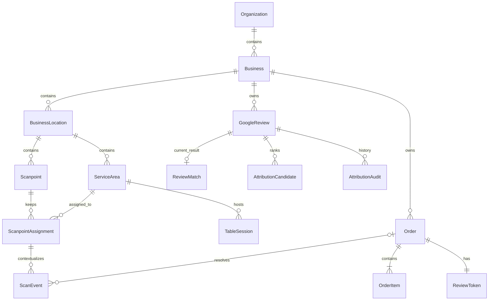

# SQLite data model

SQLAlchemy declares the schema; the four existing Alembic revisions create and evolve it. Application connections enable `PRAGMA foreign_keys=ON` and a five-second busy timeout. Alembic's SQLite batch migration connection is separate; migrations should run with the application stopped. The migration regression test checks a fresh database against current metadata.

| Entity | Responsibility and important invariant |
|---|---|
| Business / location / service area | Scope mock data and table context; external area refs are unique per location |
| Scanpoint | Stable opaque public URL; serial number unique within a business |
| ScanpointAssignment | Historical table assignment with start/end timestamps; old rows remain after moves |
| TableSession | Mock visit context; external session ID unique per business |
| PosConnection | Identifies a mock ingestion source; no demonstrated real POS connection |
| Order / OrderItem | Canonical mock order and decimal item prices; external order ID unique per business |
| ReviewToken | Compatibility per-order QR path; one token per order |
| ScanEvent | One row per public visit; can temporarily lack order/table-session linkage |
| GoogleReview | Historical model name, also stores simulated reviews; provider ID unique per business |
| ReviewMatch | Replaceable current result; one per review and at most one selected review per scan |
| AttributionCandidate | Ranked scan evidence; unique review/scan pair |
| AttributionAudit | Historical snapshots appended by application matching runs |

Organisation, user and membership tables are groundwork only. There is no implemented owner login or role enforcement in this prototype.

Indexes cover business IDs, scan/business/time lookup, assignments, table-session intervals, and review creation time. Current matching still loads collections rather than exploiting all indexes for a bounded query. API validation enforces ratings, quantities, input lengths and monetary totals; these range checks are not all SQLite CHECK constraints. Business consistency between related foreign-key targets is primarily enforced by service/API scoping, not composite foreign keys. Assignment interval overlap is handled by service code, not an exclusion constraint.

Do not publish local `.db`, `.db-wal`, `.db-shm`, SQLite backup or environment files. Useful synthetic examples live in tests and the README; each new database is initialized with only a demo business/location. No private database is needed to run the app.
